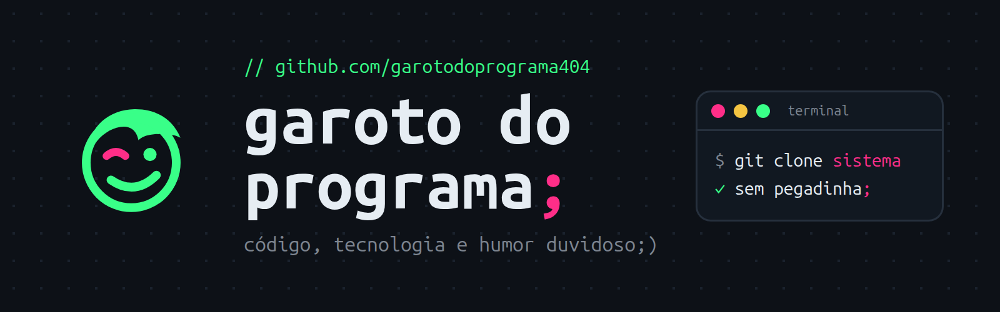

<p align="center">
  
</p>

```js
// sobre_o_garoto.js
const garoto = {
  canal: "Garoto do Programa;",
  faz: ["código", "tecnologia", "IA", "humor ácido"],
  sistemasGratis: true,   // sem pegadinha
  funcionaNaMinhaMaquina: true,
};
```

## sistemas grátis pra comunidade;

| sistema | pra quê |
|---|---|
| [**Balconista;**](https://github.com/garotodoprograma404/balconista) | a IA que atende seus clientes no WhatsApp: mostra produto, preço e estoque de verdade, anota o pedido pra você confirmar e te chama no fiado, na troca e no cliente bravo. Testada em 30 conversas cheias de armadilha (89 de 90). É o Chat do Garoto 2.0, com OpenRouter ou um Ollama seu |
| [**Chat do Garoto;**](https://github.com/garotodoprograma404/chat-do-garoto) | seu WhatsApp, seus clientes, produtos e vendas (com fiado em parcelas) num app só, cifrado no aparelho e **sem servidor**. Flutter + Go, Android e Linux. Tem modo demonstração pra testar sem conectar nada |
| [**Pente-fino do Garoto;**](https://github.com/garotodoprograma404/pente-fino) | recebeu um projeto pra abrir (teste técnico, repo de desconhecido)? ele diz em português o que a pasta faria sozinha no seu computador, só lendo, sem executar nada. Python puro, nada pra instalar |
| [**Bolha do Feed;**](https://github.com/garotodoprograma404/bolha-do-feed) | um algoritmo de recomendação de brinquedo pra ver uma bolha nascer de uma regra só: curtiu? mostra mais. Python puro, nada pra instalar |
| [**Urna do Garoto;**](https://github.com/garotodoprograma404/urna-do-garoto) | uma urna didática em que a fraude não consegue se esconder: voto cifrado, chave dividida em 5 e um verificador que qualquer um roda. o vilão tenta 22 golpes. Python puro, nada pra instalar |
| [**Detector de Lábia;**](https://github.com/garotodoprograma404/detector-de-labia) | lê uma ligação ou mensagem e procura os sinais clássicos de golpe por telefone e WhatsApp. Python puro, nada pra instalar |
| [**Audita Aí;**](https://github.com/garotodoprograma404/audita-ai) | confere você mesmo se a soma dos boletins de urna bate com o resultado oficial do TSE. Python puro, nada pra instalar |

*(tem mais vindo. segue o garoto pra não perder)*

## onde me achar;

[](https://instagram.com/garotodoprograma)
[](https://tiktok.com/@garotodoprograma)

<sub>// feito pelo Garoto do Programa; · código aberto, humor duvidoso;)</sub>
